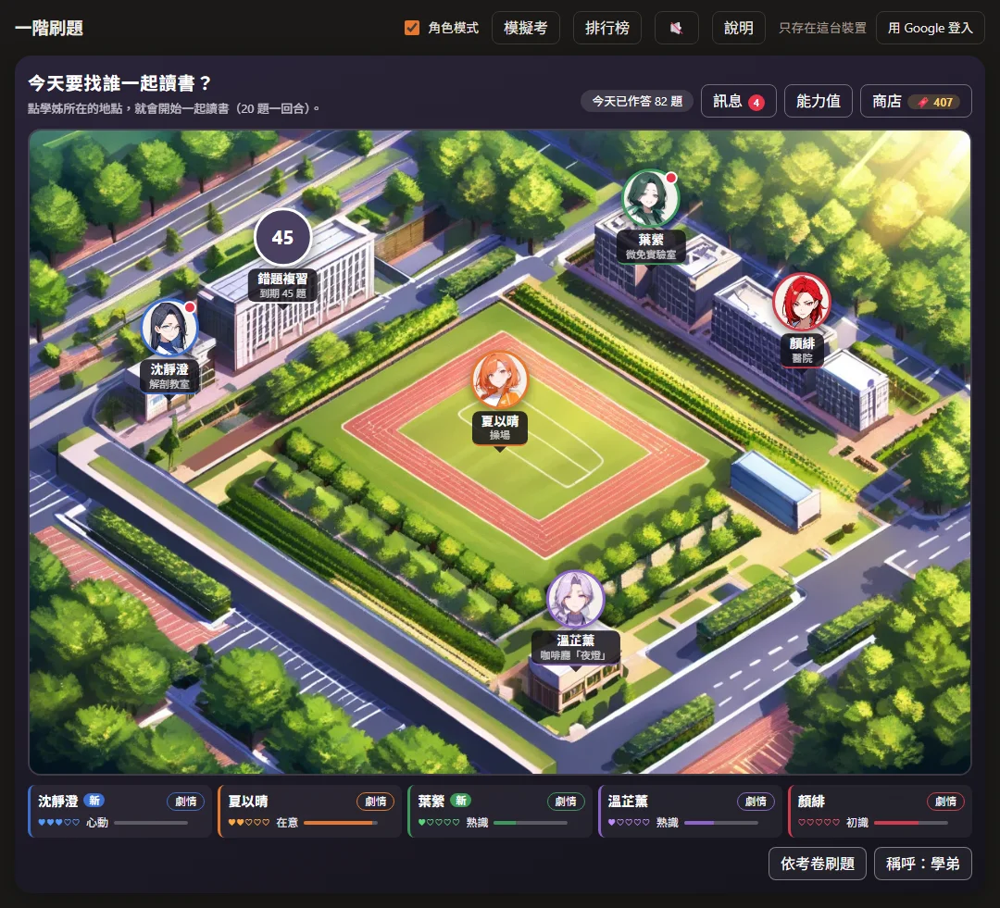
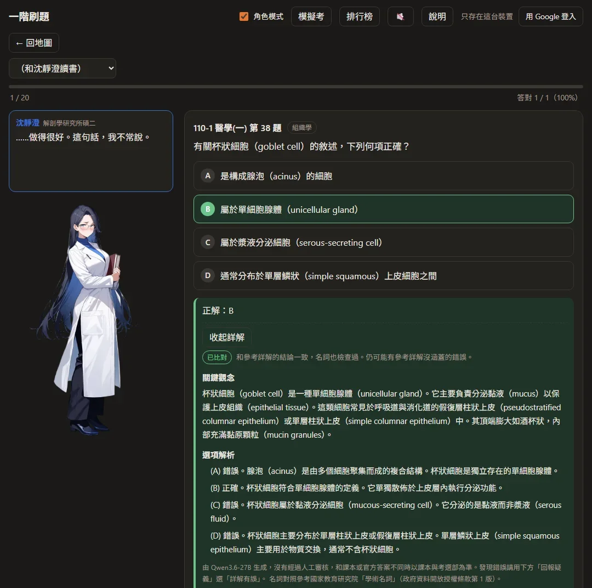
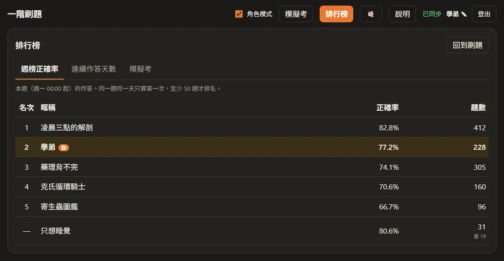
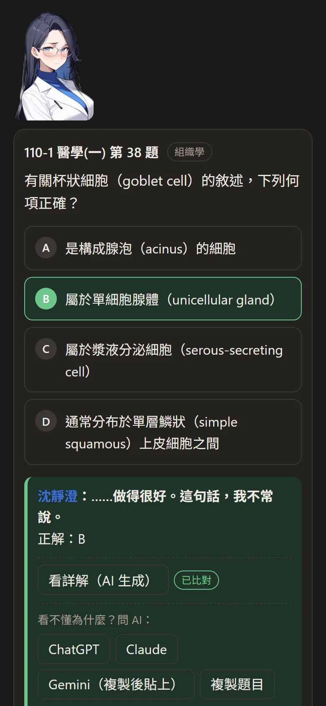
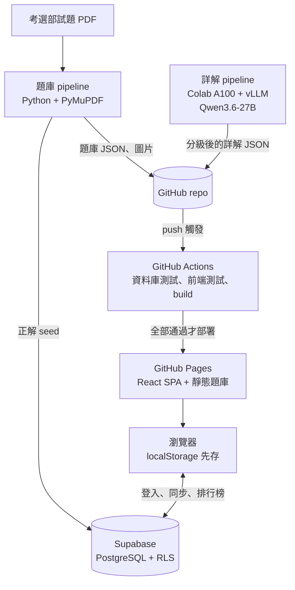

# 醫師一階攻略～五位學姊陪你考過～


用考選部 110–115 年醫師第一階段考試歷屆試題刷題的 galgame 風格網站（24 份考卷、2,399 題）。五位學姊各負責幾個學科陪你讀書，答題表現推進好感度與劇情；朋友之間有排行榜。免費，不登入也能用。

**網站**：https://rogerh0711.github.io/nmle/

## 遊戲畫面


<p><b>劇情</b>：好感度升到下一個階段，就解鎖那位學姊的劇情。圖是沈靜澄的「心動」：閉館前的書架間，她的眼鏡掉了。</p>

<table>
  <tr>
    <td width="50%" valign="top">
      
      <p><b>校園地圖</b>：五位學姊各在自己的地點，點誰就和誰一起讀書，20 題一回合。愛心是好感度，「新」表示有還沒看的劇情。</p>
    </td>
    <td width="50%" valign="top">
      
      <p><b>一起讀書</b>：答對答錯學姊都有反應，好感度越高話越多。作答後可以展開 AI 詳解，依比對結果分級標示。</p>
    </td>
  </tr>
  <tr>
    <td valign="top">
      
      <p><b>商店</b>：答對新題目、按時複習錯題就能賺書籤，買禮物或服裝送學姊。換上的服裝在地圖和刷題時都看得到。</p>
    </td>
    <td valign="top">
      
      <p><b>排行榜</b>：本週正確率、連續作答天數、模擬考成績，只顯示暱稱。（截圖的暱稱是示範資料）</p>
    </td>
  </tr>
</table>

<p align="center">
  
  &nbsp;
  
</p>
<p align="center">手機也能用。學姊會傳訊息：錯題到期、連續作答幾天、有新劇情。</p>

## 功能

- **刷題**：依學姊（學科）或整份考卷刷題，作答後馬上顯示正解；電腦可以用鍵盤作答。
- **錯題複習**：Leitner 間隔複習，答錯的題目在 1、3、7、14 天後回來。
- **模擬考**：一份考卷 100 題限時 2 小時，交卷才看答案，成績進排行榜。
- **排行榜**：本週正確率、連續作答天數、模擬考成績，只顯示暱稱。
- **角色**：五位學姊的立繪、台詞、好感度與各五段劇情、傳訊息、送禮物和服裝；可以關掉角色模式，只留刷題功能。
- **詳解**：AI 生成，和學生編寫的參考詳解比對結論、檢查名詞，依結果分級標示。
- **回報疑義**：不登入也能回報題目、答案、圖片或詳解的問題。
- **離線可用**：作答紀錄先存在瀏覽器，登入後跨裝置同步。可以用 Google 登入，或用不需要 Email 的帳號密碼。

## 架構



只有「需要跨裝置或讓朋友互相看到」的資料經過 Supabase，其餘（題庫、角色、台詞、詳解）都是隨網站部署的靜態檔，作答不必等後端。

## 技術重點與取捨

**離線優先、紀錄只增不改**
作答、模擬考、送禮都是只能新增的紀錄，id 由前端產生，重送不會重複。錯題複習進度、好感度、書籤餘額都不存，每次由紀錄推算。兩台裝置同時離線作答再同步，也不會互相覆蓋；之後調整複習間隔或好感度門檻，也不用搬資料。

**權限放在資料庫**
每張表都開 Row Level Security，只能讀寫自己的資料。排行榜由 `security definer` 函式彙總，只回傳暱稱與統計數字。正解只放在前端讀不到的 `question_keys`，作答寫入時由 trigger 判斷對錯，蓋掉瀏覽器送來的值。
取捨：作答後要顯示正解，正解仍然會送到瀏覽器，有心人可以先看正解再作答。要完全防刷分，得改成作答後才向伺服器拿正解，代價是不能離線作答。目前選擇保留離線。

**資料庫測試跑真的 migration**
用 PGlite（編譯成 WebAssembly 的 Postgres）模擬 Supabase 的 auth schema 與角色，依序套用所有 migration 和正解 seed，再以不同身分測試讀寫權限、判分、排行榜、刪除帳號。CI 沒過就不部署。

**題庫 pipeline**
從考選部 PDF 解析題幹、選項、圖片與答案（含更正答案、送分、一題多解）。每份考卷自動檢查題數、選項與答案，有問題的題目先不出題。人工修正寫成 override 並註明原因，不直接改產出的 JSON。

**AI 詳解：不付 API 費用，靠比對把關**
- 用開源模型 Qwen3.6-27B（FP8）在 Colab A100 上以 vLLM 批次生成：一次開機、模型只載入一次，依序跑完生成、比對、名詞判斷。本機的總控程式每 5 分鐘下載一次結果當紀錄點，執行環境斷掉會重開一台接著做。
- 比對：程式先把生成的詳解切成編號的句子，模型只回每一句和參考詳解是「一致／矛盾／未提及」。參考詳解的文字不會流進網站上的內容。
- 名詞檢查：生成時要求專有名詞寫成「中文（English）」，再用國家教育研究院的學術名詞和題庫裡的用法對照，對不上的才交給模型判斷。
- 取捨：比對擋得住和參考詳解衝突的錯，擋不住參考詳解沒寫到的內容。所以網站全部顯示、分級標示，並提供「詳解有誤」的回報管道，不把「已比對」當成保證正確。

**隱私**
不用追蹤 Cookie 或分析工具。使用統計只記隨機的裝置代碼和每天作答題數，連不回帳號。排行榜的預設暱稱不是真名。使用者可以自己刪除帳號與所有雲端紀錄。詳見[隱私權政策與使用條款](https://rogerh0711.github.io/nmle/privacy.html)。

**載入速度**
React 與 Supabase 套件分開打包，部署新版時瀏覽器沿用套件快取。資料檔網址帶上部署的 commit，避免新程式配到快取裡的舊資料。校園地圖依螢幕寬度只載入橫式或直式其中一張。

## 專案結構

| 路徑 | 內容 |
| --- | --- |
| `web/` | Vite + React + TypeScript 前端 |
| `data/` | 網站的靜態資料：題庫、角色、台詞、劇情、立繪、詳解（Vite 的 `publicDir`） |
| `supabase/` | migration、正解 seed、PGlite 資料庫測試 |
| `pipeline/` | Python：解析考選部 PDF（`build_exam.py`）、AI 詳解（`explain/`） |
| `art/` | Colab 立繪與背景 notebook |
| `docs/design.md` | 設計與決策紀錄 |

## 開發

Node 版本見 `.node-version`。

```bash
npm ci && npm ci --prefix web       # 安裝
npm --prefix web run dev            # 本機網站 http://localhost:5173
npm test                            # 資料庫測試 + 前端測試
npm run build --prefix web          # 型別檢查 + build
```

解析考卷（需要 Python 與 `pipeline/requirements.txt`）：

```bash
python pipeline/build_exam.py --years 110 115
python pipeline/export_keys.py      # 題庫變動後重新產生正解 seed
```

## 出處與授權

程式碼以 [MIT 授權](LICENSE) 釋出。MIT 只涵蓋程式碼；題庫、名詞對照、詳解與美術素材的來源和使用限制如下：

- 試題與答案：考選部公開之醫師第一階段考試歷屆試題。依著作權法第 9 條，考試試題不受著作權保護。正解以考選部公告（含更正答案）為準。
- 名詞對照：國家教育研究院「樂詞網」學術名詞，依政府資料開放授權條款第 1 版使用。
- 詳解：Qwen3.6-27B 生成，未經人工審核。
- 角色立繪與背景：Animagine XL 4.0 生成；立繪去背使用 BRIA RMBG-2.0（CC BY-NC 4.0，限非商業使用）。
